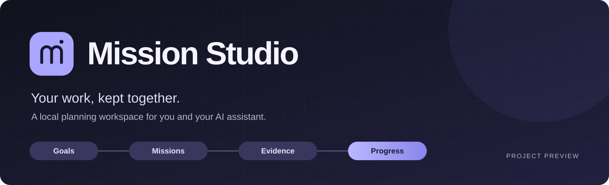
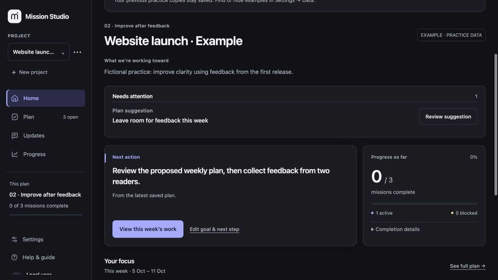

<a href="docs/GUIDE.md">Explore the workflow</a> · <a href="docs/ROADMAP.md">Direction & status</a> · <a href="https://github.com/DavidMasino/mission-studio/issues/new?template=feedback.md">Share feedback</a>

## Why I built it

Working on projects like Solquante and Wallet Lab with AI assistants made one need clear: a reliable place to see the goal, this week's work, the evidence behind progress and the next useful step.

I built Mission Studio to keep that plan together. I can update it myself, and an authorized project assistant with access to the local workspace can update the same saved record. Each conversation can then continue from the plan and evidence already there.

## What it does today

- **See the next step.** Home brings together the project goal, saved next action and progress.
- **Plan at different levels.** Connect longer-term milestones to weekly missions with clear completion criteria.
- **Keep progress explainable.** Record results, evidence references, reviews and blockers alongside each mission.
- **Review changes.** Inspect suggested changes and exact dates before accepting them into the plan.
- **Look back clearly.** Prepare a factual weekly-summary draft from dated saved activity, then review and save it.
- **Keep a durable record.** The interface and local assistant commands share one store, with saved history, backups and protection against conflicting edits.

<table>
<tr>
<td width="50%"> <strong>This week's work</strong></td>
<td width="50%"> <strong>The bigger picture</strong></td>
</tr>
</table>

Screenshots show the working local app with fictional example data. They are demonstrations, not claims of completed real-world work.

## A simple workflow

1. Define the project and the result you want.
2. Break the work into missions and organise the weeks.
3. Work with your assistant, keeping results and evidence in the shared plan.
4. Review suggestions and decide what changes.
5. Save a weekly summary and carry the useful next step forward.

[Read the preview guide →](docs/GUIDE.md)

## Where it fits

Mission Studio is useful on its own. It also supports **Project 000**, the broader foundation I am developing for setting up and running projects with AI. A deeper integration is still a direction being explored.

The longer-term idea includes working with colleagues as well as AI assistants. The current app runs on one trusted local computer; hosted team collaboration is not available yet.

## Current status

**Public project preview · actively developed through my own projects.**

This repository contains screenshots, a workflow guide and the project's direction. It does not contain the application source or an installable release. Open-source licensing and commercial availability have not been decided.

The current implementation uses Python and vanilla HTML, CSS and JavaScript on macOS/Linux. It has no built-in model connection, automatic chat synchronization or unattended agent execution. An assistant needs explicit access and permission to work with the local record. Evidence references and contributor labels are recorded information, not automatic verification or authenticated identities.

[What works now and what comes next →](docs/ROADMAP.md)

## Would this help your workflow?

I am interested in how you organise projects with AI, where context gets lost, and what would make a shared plan useful to you.

[Share a use case or suggestion](https://github.com/DavidMasino/mission-studio/issues/new?template=feedback.md). Please use fictional examples and leave out private project information.

Built by [David Masino](https://github.com/DavidMasino). Preview updated 9 October 2026.
