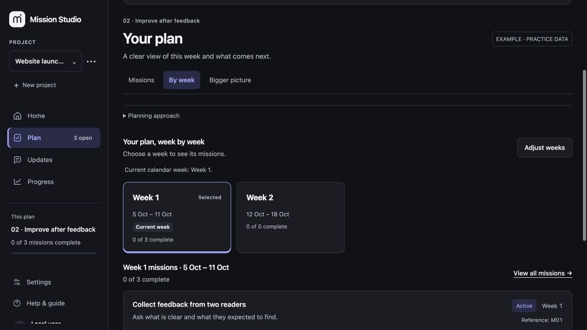
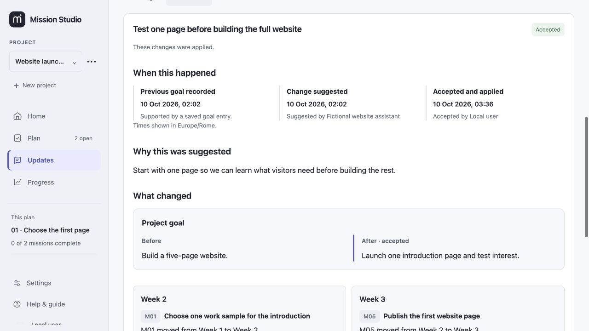
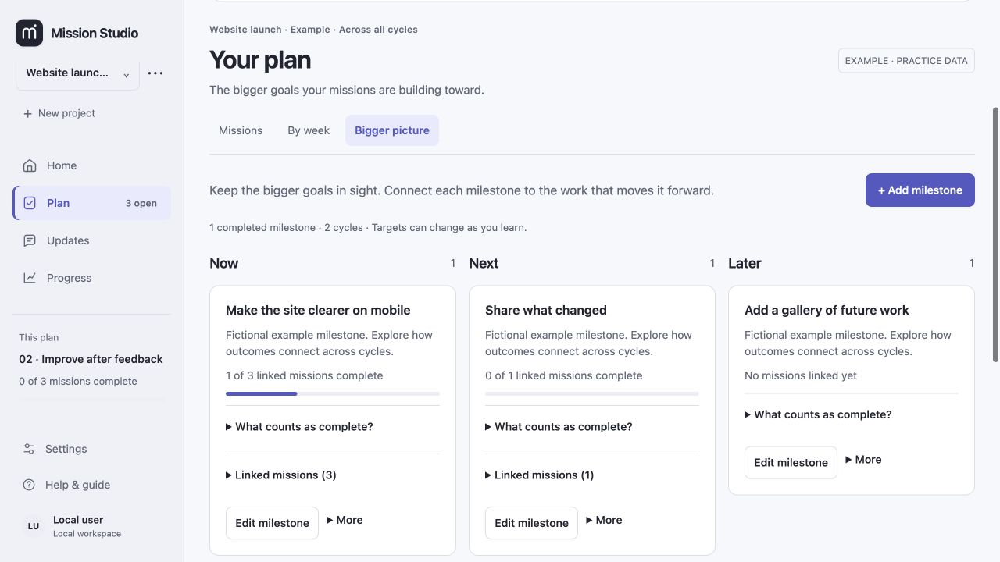

# Mission Studio · Preview guide

[← Back to Mission Studio](../README.md)

Mission Studio helps you answer three questions: **Where are we? What comes next? What needs my decision?**

Mission Studio is currently a private prototype. This guide describes the local app shown in the public preview; no public download, trial or hosted account is available yet. [Tell me if you would like to try it](https://github.com/DavidMasino/mission-studio/issues/new?template=feedback.md).

## Start with one useful result

Create a project with a name and a goal. A *mission* is a useful piece of work with a clear finish line. A *cycle* is a focused period of work within the project. Schedule and extra details can be adjusted as you need them.

For example, a website project might have missions to gather feedback, improve the phone layout and write a launch update. Each mission keeps its permanent reference, such as **M01**, even when its title or planned week changes.

## Find your way around

| Place | Use it for |
| --- | --- |
| **Home** | The goal, saved next action, progress and items needing attention. |
| **Plan → Missions** | Each mission's current situation, next action, dependencies and completion criteria. |
| **Plan → By week** | This week's work and the weeks ahead. |
| **Plan → Bigger picture** | Longer-term milestones organised into Now, Next and Later. |
| **Updates → To review** | Requests needing preparation or a decision, and saved confirmations. |
| **Updates → Suggestions** | Proposed changes and their recorded decisions. |
| **Progress → Weekly summaries** | What was recorded for each week, what remained open and the next focus at that time. |
| **Progress → Activity** | The history of saved changes. |

## Work from the same plan as your assistant

You can use the interface yourself. An authorized assistant with access to the local workspace can read and update the same record through the app's command interface. It should read the latest version, make the scoped update and check what was saved.

The app does not automatically read your chats or connect to an AI model. A copy-message action prepares text for you to paste into the relevant conversation; copying alone sends nothing.

A colleague can take part in your planning process, but the current app does not provide remote team accounts, permissions or live multi-user collaboration.

## Record progress with context

Open a mission to see its current situation and what counts as finished. Keep the next action short and useful. Add supporting evidence references and record the review and result when the work is ready.

In **Plan → Missions**, use **Planned** beside All, Active, Blocked and Complete to find work that has not started. The count shows how many missions match.

A next action can also carry **Decision needed**. Its decision choice and explanation are visible in **Current situation**. Saving other progress keeps that request open. To settle it, explicitly choose that no decision remains and record what you decided and why. This planning decision is separate from accepting an evidence review.

A mission's **status** describes where the work stands. Its **outcome** describes what it found. An investigation can be complete even when the result is negative or inconclusive. Completion requires recorded evidence, an accepted review, an outcome and completed dependencies.

Evidence entries are references to supporting material. Mission Studio does not fetch or independently verify that material. A reviewer name is a recorded label; it does not prove independent review.

## Review a proposed change

Open **Updates → Suggestions** to review a suggested change. The card shows the full recorded reason and a comparison of the previous and proposed values. Project goals, mission goals, descriptions and completion criteria are distinguished from week moves. A schedule-only suggestion explicitly says the mission's goal, description and completion criteria stay the same. Mission references such as **M01** help you follow the same item through the details.

After acceptance, the comparison shows the changes actually applied, including any adjustments made during review. The original suggestion and the decision note remain available. If the older value was not recorded with a suggestion, the comparison says so.

In **Updates → To review**, an automatic date proposal offers **Accept & update plan** to save the reviewed week changes. **Keep current plan** retains the existing dates. Assistant suggestions also offer a route to request changes.

Automatic date proposals are limited calendar adjustments within an active cycle. They do not resolve blockers, authorize new work or prove the workload fits your time. Opening the app does not silently move missions. Unknown effort stays unknown.

## Follow a goal change over time

**Plan** shows the **current goal** with a **View goal changes** link. Follow it to **Updates → Suggestions → Decisions** for the saved comparisons, reasons and timelines. An accepted goal change includes its previous and accepted goals, the full recorded reason and its chronology:

- **Previous goal recorded:** the saved date when reliable history supports it. If that date is unavailable, it is shown as unknown.
- **Change suggested:** when the suggestion was recorded and its recorded source.
- **Accepted and applied:** when the accepted changes were saved and who or what was recorded as making that decision.

Dates include a clear timezone. A suggestion's date is not used as the previous goal's original date, and a pending suggestion has no acceptance date. Source and decision-maker labels are recorded information; they do not authenticate a person or prove independent review.

This is the history of an accepted suggestion, not a complete history of every goal edit. A later direct edit or restore may leave the current goal different from that accepted goal. The historical reason remains attached to the accepted change; it is not presented as the reason for a later goal. Direct edits do not require a suggestion reason.

## Prepare a weekly summary

For a missing ended week, choose **Prepare Week N summary** in Updates or Progress.

1. Read the unsaved draft assembled from that week's dated saved activity.
2. Review or edit the result, what remains open and the next focus.
3. Check the supporting context and any recorded gaps.
4. Tick **I checked this summary against the saved notes**, then choose **Save summary**.

The draft is prepared locally without a model call. It describes what was recorded, rather than reconstructing all work that may have happened. Saving the summary does not move the plan or complete missions. Prepare each missing week separately.

**Mark read** means you have seen an update. It does not resolve unfinished work or replace a decision.

## Keep the bigger picture visible

Use **Plan → Bigger picture** to connect milestones to missions across cycles. Now, Next and Later describe your intended direction. Completed milestone records preserve the result that was recorded at completion.

## Make it comfortable to use

Under **Settings → Appearance**, choose **Light**, **Dark** or **System** mode. Colour choices include **Graphite / Periwinkle**, **Midnight / Cyan** and **Warm Studio / Orange**, with Indigo, Violet and Green also available. Text size and spacing are adjustable.

Appearance settings belong to the browser. Your plan and progress belong to the shared local record.

## Save with confidence

Watch the saved or error feedback after an edit. If another writer changes the record while your form is open, the app keeps your draft and asks you to reconcile it with the newer version. It does not silently overwrite the newer work.

Before copying a whole-workspace backup, stop the local service and any assistant writes. Keep the complete data folder together, including backups and lock information. A selected-cycle export does not back up every project.

## What is still ahead?

A clearer daily focus, easier assistant onboarding and possible team workflows are directions to explore. They are not promises of a release or currently available features. See [direction and status](ROADMAP.md).

Guide updated 10 October 2026. All pictured project content is fictional.
